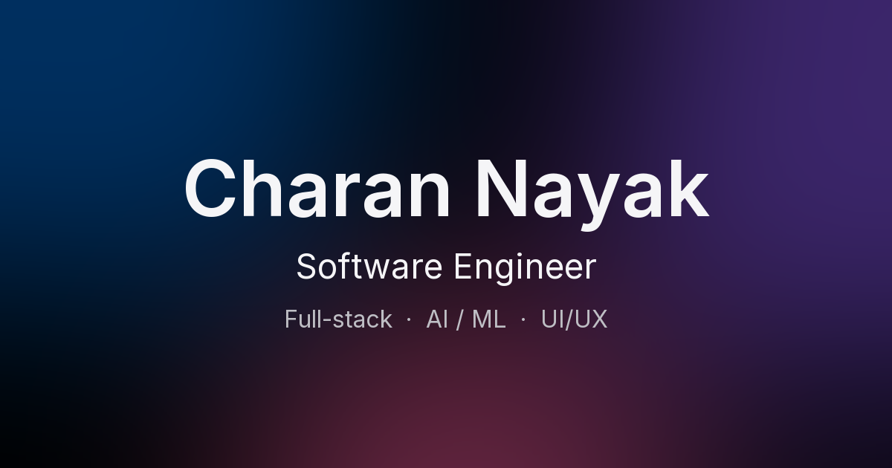

# Charan Nayak — Portfolio

My personal portfolio: the projects I've built, my experience, and how to reach me.
I'm a software engineer working on full-stack web applications and on LLM training
and evaluation.



## What's in it

- **Home**: an intro, selected projects, measured results, recent experience and contact.
- **Work**: every project, each with its own case study (problem, solution,
  architecture, decisions, performance).
- **Experience**, **About**, **Skills** and **Contact** pages.

## Built with

- [React 19](https://react.dev) and [React Router](https://reactrouter.com)
- [Vite](https://vite.dev)
- [Tailwind CSS 4](https://tailwindcss.com)
- [Framer Motion](https://motion.dev) for scroll and page motion
- [Lucide](https://lucide.dev) icons and the [Inter](https://rsms.me/inter/) typeface

The design follows Apple's Human Interface Guidelines: San Francisco type on Apple
devices, glass only on the navigation, 44px minimum touch targets, and text
contrast that meets WCAG AA.

## Run it locally

You need [Node.js](https://nodejs.org) 20.19+ or 22.12+ (required by Vite 8).

```bash
npm install
npm run dev       # dev server at http://localhost:5173
npm run build     # production build in dist/
npm run preview   # serve the production build
```

## Editing the content

Most content lives in `src/data/`, so most edits don't touch any components. The hero
headline is in `src/sections/Hero.jsx` and the scrolling statement in
`src/sections/Statement.jsx`.

| File | What it holds |
|---|---|
| `src/data/profile.js` | Name, email, links, résumé link, nav links, education, certification, headline figures |
| `src/data/projects.js` | Projects and their case studies |
| `src/data/experience.js` | Roles, newest first |
| `src/data/skills.js` | Skill groups and the stack diagram |

### Project images

Each project image is a 1600×1000 (16:10) `.webp` in `public/projects/`, named after
the project's `slug`. A wide browser screenshot can be any size instead: add
`frame: 'browser'` to the project's `image` and it's shown whole, inside a browser
window. Until an image exists, a soft gradient stands in for it.

## Project structure

```
src/
  components/   reusable pieces (buttons, cards, motion wrappers, navbar)
  sections/     page sections (hero, project list, timeline, contact)
  pages/        one file per route
  data/         all site content
  hooks/        media-query and page-title hooks
  lib/          shared motion settings
  index.css     theme colours, type scale, glass and motion styles
public/         favicon, share image, project images
```

## Accessibility

- Follows the system's light/dark mode.
- Respects **reduce motion** (no scroll or entrance animation), **increase contrast**
  (stronger secondary text and borders) and **reduce transparency** (solid glass,
  no background colour).
- Full keyboard navigation, a skip-to-content link and visible focus rings.

## Deployment

It's a single-page app, so every path has to serve `index.html`. Both configs
for that are included:

- **Vercel**: `vercel.json`
- **Netlify**: `public/_redirects`

Build command `npm run build`, output directory `dist`.

## Contact

- Email: [charannaikcharan734@gmail.com](mailto:charannaikcharan734@gmail.com)
- LinkedIn: [charan-naik-charan](https://www.linkedin.com/in/charan-naik-charan)
- GitHub: [charannaik07N](https://github.com/charannaik07N)
